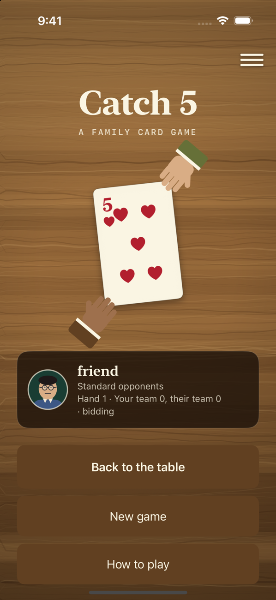
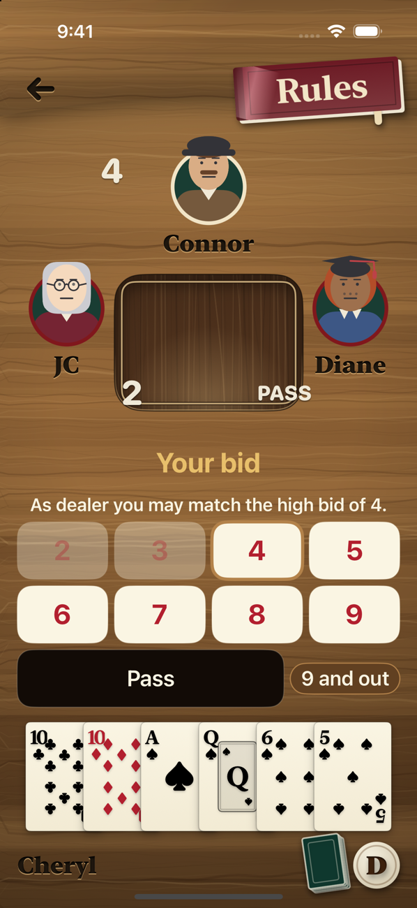
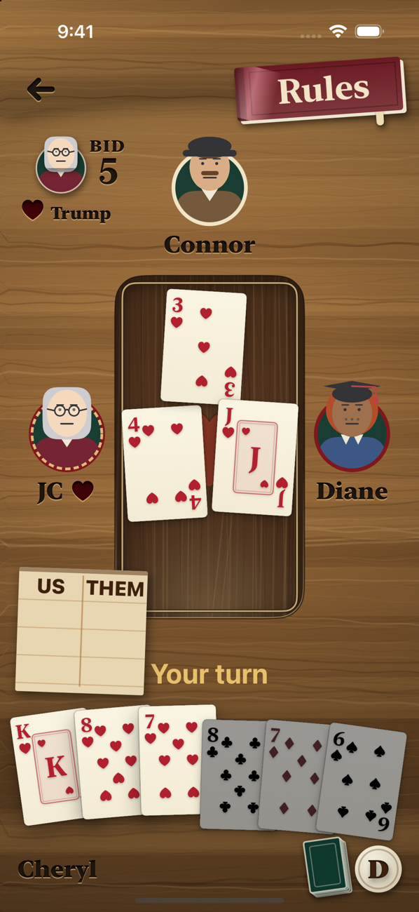
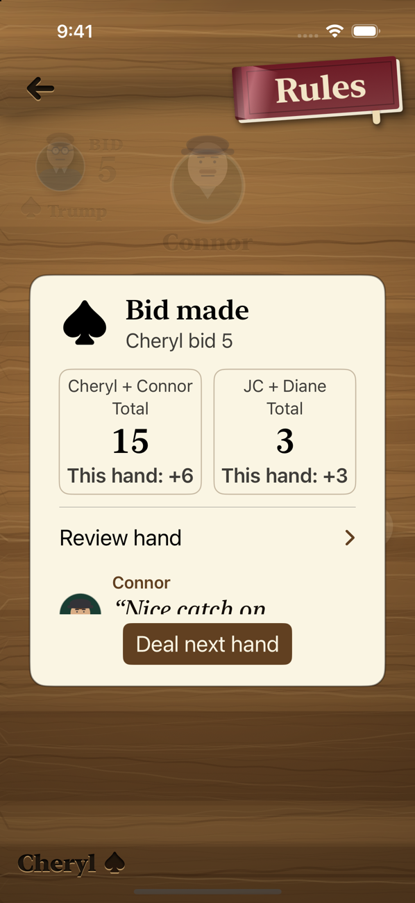

# Catch 5

[](https://github.com/cmurphy1140/catch-5/actions/workflows/tests.yml)

A SwiftUI iPhone card game for Murph's family: it plays their house rules of Catch 5 (Pitch with Fives) against three computer opponents and teaches the game as you play.

**Serves:** Murph's family, learning Catch 5 · codename **Salina** (Aeolian Islands) · vault note [Projects/active/catch-5/catch-5](obsidian://open?vault=Archipelago&file=Projects%2Factive%2Fcatch-5%2Fcatch-5)

**Status:** stage **alpha**, parked. Checked 2026-10-15: swift test 264 passed, 0 failed.

**Run:** `scripts/check.sh`. CI runs the same command on every push to `main`.

**Start here:** [House rules](docs/catch-five-rules.md), then `Sources/CatchFive/`, the rules engine.

**Map**

```
Sources/CatchFive/      rules engine: dealing, bidding, tricks, scoring, computer players, saving
Sources/CatchFiveUI/    SwiftUI views and GameModel, the view model
Sources/CatchFiveDemo/  terminal demo of the engine
App/                    iPhone app entry point
Tests/                  engine and view-model suites
scripts/                check.sh, simulator build and run, icon and docs export
docs/                   house rules, plans, specs
```

## What this is not

- Not a published app. There is no App Store release, and nothing here spends money.
- Not a general Pitch engine. It plays the family's house rules; new product work belongs in plug-and-pitch, not here.
- Not the written record. Plans, progress and decisions live in the vault; `STATE.md` points there.

## Principles

1. **Read first.** Understand what exists before changing it. The record of how it was learned is part of the product.
2. **Every claim carries its check.** Checked, Recorded or UNTESTED. A note is never the proof for a later claim.
3. **Corrections stay on the record.** A wrong finding is corrected in place with the date, never erased.
4. **Private stays private.** Raw data, people, addresses, device maps and client material never enter the repo. Only facts come in, plus documents the client already hands out.
5. **Say what it is not.** Scope is written down so nobody builds the wrong thing.
6. **One place for status.** The vault note. The repo points to it.

<p>
  
  
  
  
</p>

## Features

- Solo play against three computer opponents (Easy and Standard), or pass-and-play on one phone.
- Hints, hand review with an explanation of every play, undo, and match statistics.
- Optional lessons and rule trials that use the same engine as the game.
- Save and resume from a replay log, so a match restores in any phase.
- Computer bidding tuned against a mirrored benchmark: win rate rose from 64.7% to 67.5%.

## Architecture

MVVM, in a Swift package with no external dependencies (iOS 17+ / macOS 14+).

- `Sources/CatchFive/` is the rules engine: dealing, bidding, tricks, scoring, computer players and saving. It has no UI code.
- `Sources/CatchFiveUI/` holds the SwiftUI views; `GameModel` is the view model that connects them to the engine.
- `App/` is the iPhone app entry point; `Sources/CatchFiveDemo/` is a terminal demo of the engine.

## Build and test

```bash
scripts/check.sh                      # swift test: 264 tests, 93 engine and 171 view model
python3 scripts/build-simulator.py    # builds work/simulator-build/CatchFive.app
```

`scripts/check.sh` runs in GitHub Actions on pushes to `main` and on pull requests.

## Docs

[House rules](docs/catch-five-rules.md) · [Contributor notes](AGENTS.md)
